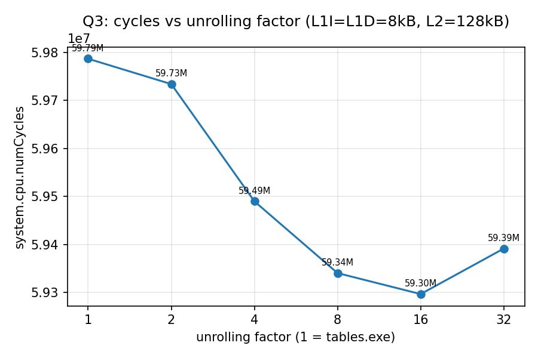
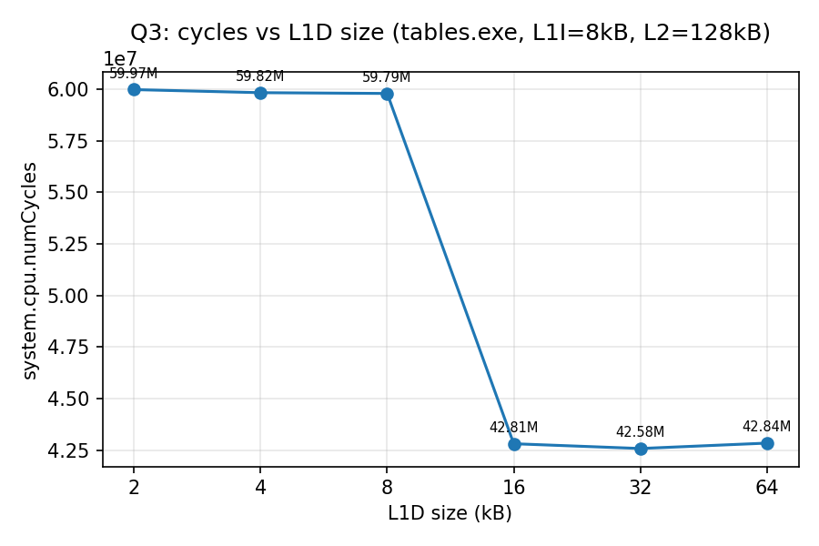
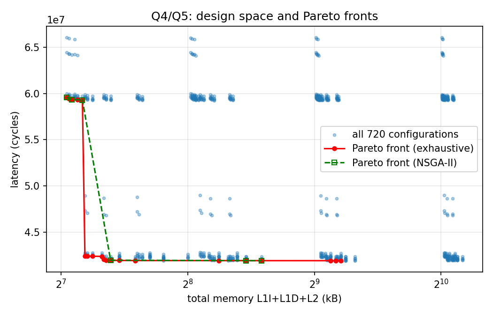

# Lab 1 – answers / report draft (Ζητούμενο 1 and 2)

Status:
- **Ζητούμενο 1:** Q1 is filled in from the datasheet. Q2–Q5 have the code ready; their
  numbers come from the board run (`results/gdb_dump.txt` → `python3 tools/analyze.py`).
- **Ζητούμενο 2 (gem5):** complete, all numbers measured (end of this file).

---

## Q1 – Board characteristics (Renesas S7G2, part R7FS7G27H3A01CFC on the SK-S7G2)

Source: *S7G2 Microcontroller Group Datasheet*, R01DS0262EU0150 Rev.1.50 (Sep 2025),
features page, Table 1.1 (Arm core), Table 1.2 (Memory), product table on p.6 and §2 (clock timing).

### Memories

| Memory | Size | Notes (datasheet) |
|---|---|---|
| Code flash | **4 MB** | "80 MHz zero wait states". Holds the program **and all `const` data**, so `current[]`/`previous[]` from `images.h` live here |
| Data flash | **64 KB** | for non-volatile user data, 125,000 erase/write cycles |
| SRAM | **640 KB** | high-speed on-chip SRAM: the first 32 KB of SRAM0 have Double-bit Error Detection (DED), the other 608 KB have parity |
| Standby SRAM | **8 KB** | keeps its contents in Deep Software Standby mode |

### Caches and their function

- **Flash Cache (FCACHE)**: the datasheet lists it under Memory. It sits in front of
  the code flash. The flash itself has zero wait states only up to 80 MHz, but the CPU
  runs at up to 240 MHz, so every flash access that misses costs extra wait cycles.
  FCACHE keeps recently read flash contents, both instructions and the `const` data
  (here the image arrays), so repeated reads hit the cache instead of paying the wait
  states. Details are in the User's Manual, flash/FCACHE section.
- **The CPU has no data or instruction cache**: the Cortex-M4 core (Armv7E-M, with FPU,
  DSP extensions and an 8-region Arm MPU, per Table 1.1) has no built-in L1 caches. That
  is a property of the Cortex-M4 itself. So the only cache on the path to memory is
  FCACHE, and it serves **only the code flash**. Accesses to SRAM (stack, locals, globals,
  non-`const` arrays) are not cached but are fast on-chip accesses anyway.
- Related, but not caches: Memory Mirror Function (MMF), which maps a code-flash image to
  a mirror address, and the MPUs (memory protection).

### Clock

- **Maximum CPU clock (ICLK): 240 MHz.** Other maxima from §2: PCLKA 120 MHz,
  BCLK 120 MHz, FCLK 60 MHz.
- Main clock oscillator (MOSC) range: 8–24 MHz, multiplied up by the PLL.
- **The clock the board is actually programmed to** is read at run time:
  `hal_entry.c` stores `SystemCoreClock` in `g_core_clock_hz`. Use that value in the
  report, and you can cross-check it in e2studio → configuration.xml → *Clocks* tab.
  For the SK-S7G2 Blinky project this should be 240 MHz.
  *TODO: confirm from `g_core_clock_hz` = ________ Hz.*

---

## Q2 – Timing the original code

- Code: `phods_v0_original` in `src/phods_baseline.h` (original, unchanged).
- Timing: `DWT->CYCCNT` is enabled with the course's init code (`hal_entry.c`), then read
  right before and after each single call (`phods_runs.h`, `PHODS_RUNNER`).
  Time = cycles / `SystemCoreClock`.
- 10 runs: min / max / avg in `g_results[0]`.

| | min | max | avg |
|---|---|---|---|
| cycles | | | |
| µs | | | |

## Q3 – Code transformations

Each step is its own function. All of them give the same motion vectors as the original
(`test/host_test.c`, plus `g_all_correct` on the board).

| step | transformation | why |
|---|---|---|
| v1 `phods_v1_hoist` | loop-invariant code motion: `B*x`, `B*y` once per block; `vectors_x/y[x][y]` kept in locals; row bound check moved out of the `l` loop; init loop removed | the original recomputes the same address arithmetic and re-reads the output arrays for every pixel |
| v2 `phods_v2_bounds` | bounds-check elimination: compute the valid row/column range of each candidate once, then the inner loop has no `if`; whole out-of-frame rows use a precomputed Σ\|cur\| | 4 comparisons + a branch per pixel removed |
| v3 `phods_v3_share` | data reuse / CSE: the `i = 0` candidate is the same block in the X and Y searches, so it is computed once | 6 → 5 SADs per step (about −17 % work) |
| v4 `phods_v4_copy` | copy the current block (`const`, so in Flash) into a local RAM buffer once per block | tests the Hint: does moving the Flash data to RAM help? |

Expected effect of v4, to be confirmed with the measurements: probably small or none.
The image data is `const`, so it is in code flash behind FCACHE, and after the first
access most reads hit the cache. The local buffer, on the other hand, adds a copy per
block, and at `-O0` every local is itself a stack (SRAM) access. The same reasoning
explains why "keep values in local variables" style optimizations help less than
expected at `-O0`: the locals still live in memory, not in registers.

| step | min µs | max µs | avg µs | speed-up vs v0 |
|---|---|---|---|---|
| v0 | | | | 1.00× |
| v1 | | | | |
| v2 | | | | |
| v3 | | | | |
| v4 | | | | |

## Q4 – DSE over square block size B

- B ∈ {1, 2, 5, 10} (common divisors of N = M = 10), using the Q3 code
  (`phods_dse_<b>_<b>`). If v4 was faster than v3, set `PHODS_DSE_COPY_BLOCK 1` in
  `src/phods_instances.h` and re-run.
- Best B: ____. Relation to Q1: discuss in terms of how many blocks are processed
  (fixed overhead per block), how large a block row is compared to FCACHE / flash
  access width, and how often a candidate falls outside the frame.

## Q5 – DSE over rectangular Bx × By

- All 16 pairs Bx | N, By | M (`phods_dse_<bx>_<by>`).
- Best (Bx, By): ____.
- Heuristic to shrink the search (suggestion): the work per pixel is roughly the same
  for every configuration, and the extra cost grows with the number of blocks
  (N/Bx)·(M/By). So start from the largest blocks and search only around the best
  square B from Q4. Prefer a larger By (contiguous pixels within a row, which is better
  for the flash/cache line) over a larger Bx.

## Plot

`tools/analyze.py` produces `q2_q3.png`, `q4.png`, `q5.png`, and `q2_q5_all.png`, the
single line plot that the exercise asks for.

---

# Ζητούμενο 2 – gem5 (done on the Mac; all numbers measured)

Setup: course image `aferikoglou/gem5built:v1.0` (gem5 23.0), `learning_gem5/part1`
configs, `X86TimingSimpleCPU` at 1 GHz, DDR3-1600. In `two_level.py` the L1 caches are
2-way (2-cycle latencies) and the L2 is 8-way (20-cycle latencies). `tables*.exe` are
compiled with `gcc -O0`. Raw data: `part2/results/*.csv`; how to re-run:
`part2/README.md`.

The program (`tables.c`) streams through 4 `double` arrays of N = 100,000 elements
(800 kB each, 3.2 MB in total): one loop initialises them, one computes
`y[i] += a1*x1[i] + a2*x2[i] + a3*x3[i]`.

## Q1 – CPU + main memory only (`simple.py`)

**system.cpu.numCycles = 857,689,669**

## Q2 – with L1I 8 kB, L1D 8 kB, L2 128 kB (`two_level.py`)

**system.cpu.numCycles = 59,787,087**, i.e. **14.3× fewer cycles**.

Why: without caches every instruction fetch and every load/store goes over the memory
bus to DRAM (tens of cycles each), and the program does about 8.2 M instructions and
4.4 M data accesses. With caches:
- **Instruction fetches** (11.6 M) almost all hit L1I (miss rate 0.016 %), because the
  code is a few small loops.
- **Data accesses** mostly hit L1D or L2. Even with only 8 kB L1D, which as Q3 shows
  thrashes, the missed lines are still in the 8-way L2 (L2 miss rate 12.6 %), so they
  cost about 20 cycles instead of a DRAM access.

## Q3 – unrolling factor and L1D size

| UF | 1 (tables.exe) | 2 | 4 | 8 | 16 | 32 |
|---|---|---|---|---|---|---|
| cycles (M) | 59.79 | 59.73 | 59.49 | 59.34 | **59.30** | 59.39 |

**Unrolling helps only a little (−0.8 % at best, UF = 16).**
- **The gain:** unrolling removes loop overhead: at `-O0` the counter `i` lives on the
  stack, so every iteration loads, increments, stores and compares it. L1D accesses drop
  from 4.44 M to 4.06 M at UF = 16.
- **Why it's small:** the run time is dominated by data-cache misses (≈ 817 k L1D misses
  with this 8 kB L1D), which unrolling doesn't change.
- **Why UF = 32 is worse:** the loop body grows (`tables_uf32.exe` has 7.3 kB of code
  vs 1.9 kB for `tables.exe`), so the instruction-cache footprint grows and the
  benefit is gone (see Q4: with a 2–4 kB L1I, UF 16/32 become much slower).

| L1D | 2 kB | 4 kB | 8 kB | 16 kB | 32 kB | 64 kB |
|---|---|---|---|---|---|---|
| cycles (M) | 59.97 | 59.82 | 59.79 | **42.81** | 42.58 | 42.84 |
| L1D misses | 824 k | – | 817 k | 110 k | – | 102 k |

**There is a cliff between 8 kB and 16 kB (−28 %), and almost nothing changes before or
after it.** The arrays are far bigger than any of these caches (3.2 MB), so this is not
about capacity. It's about **conflict misses**:
- **Where the arrays end up.** In gem5 SE mode physical pages are given out on first
  touch. The init loop touches `x1[i], x2[i], x3[i], y[i]` in turn, so their pages end
  up **consecutive in physical memory, 4 kB apart**. (Virtual addresses checked inside
  gem5: the arrays are 0xC4000 apart, all at offset 0x010 in their page.)
- **What one cache way covers.** A 2-way cache of size C has a "way" of C/2 bytes. Two
  addresses that differ by a multiple of C/2 map to the same set.
- **≤ 8 kB:** the way is ≤ 4 kB, so **all four arrays map to the same set**. Each
  iteration needs 4 lines in a 2-line set, so every access evicts a line that is needed
  again soon (thrashing). Result: ~817 k misses, about one per array access.
- **16 kB:** the way is 8 kB, so `x1`/`x3` share one set and `x2`/`y` another: 2 lines
  per set, which fits. Misses fall to ~110 k ≈ the compulsory minimum (3.2 MB / 64 B
  = 50 k lines, read once in each of the 2 loops).
- **32/64 kB:** nothing left to gain; there is no reuse beyond one line.
- **Takeaway:** associativity and the alignment of the data matter more than raw size
  for this access pattern.

## Q4 – exhaustive DSE (720 simulations)

Space: L1I, L1D ∈ {2..64 kB}, L2 ∈ {128..1024 kB}, UF ∈ {2, 4, 8, 16, 32}.
All results: `part2/results/q4_exhaustive.csv`.
- **Time:** 720 simulations took **688 s** wall time with 10 in parallel. The sum of the
  single-simulation times is **114 min**, i.e. what a sequential exhaustive search costs.
- **Best latency:** 41,922,998 cycles (L1I 16 kB, L1D 64 kB, L2 512 kB, UF 16, 592 kB in
  total).
- **Worst:** 66,060,573 (2 kB / 2 kB / 128 kB / UF 32).

**Pareto front** (`paretoset`, minimise totalMemoryKB and latencyCC) → 20 points,
`part2/results/q4_pareto.csv`:

| L1I | L1D | L2 | UF | total kB | latency (cycles) |
|---|---|---|---|---|---|
| 2kB | 2kB | 128kB | 8 | 132 | 59,581,198 |
| 2kB | 4kB | 128kB | 8 | 134 | 59,433,698 |
| 4kB | 4kB | 128kB | 16 | 136 | 59,343,511 |
| 4kB | 8kB | 128kB | 16 | 140 | 59,306,017 |
| 8kB | 8kB | 128kB | 16 | 144 | 59,296,471 |
| **2kB** | **16kB** | **128kB** | **8** | **146** | **42,416,612** ← knee |
| 4kB | 16kB | 128kB | 16 | 148 | 42,409,832 |
| 8kB | 16kB | 128kB | 16 | 152 | 42,403,308 |
| 16kB | 16kB | 128kB | 16 | 160 | 42,387,518 |
| 2kB | 32kB | 128kB | 8 | 162 | 42,078,234 |
| 4kB | 32kB | 128kB | 16 | 164 | 41,969,420 |
| 8kB | 32kB | 128kB | 16 | 168 | 41,969,226 |
| 16kB | 32kB | 128kB | 16 | 176 | 41,945,801 |
| 32kB | 32kB | 128kB | 16 | 192 | 41,936,488 |
| 16kB | 32kB | 256kB | 16 | 304 | 41,933,039 |
| 64kB | 32kB | 256kB | 16 | 352 | 41,928,359 |
| 64kB | 64kB | 256kB | 16 | 384 | 41,925,024 |
| 16kB | 32kB | 512kB | 16 | 560 | 41,923,846 |
| 32kB | 32kB | 512kB | 16 | 576 | 41,923,699 |
| 16kB | 64kB | 512kB | 16 | 592 | 41,922,998 |

What the space shows:
- **L1D ≥ 16 kB is what matters** (the conflict-miss cliff from Q3): about −29 %
  latency for +2–14 kB. The knee of the front is **2 kB L1I / 16 kB L1D / 128 kB L2,
  UF 8** (146 kB, 42.4 M cycles). Beyond it, adding memory buys < 1.2 %.
- **L2 size barely matters** (best latency per L2 size is within 0.05 %). The data is
  streamed once, so a larger L2 has nothing to reuse, and the smallest L2 dominates
  most of the front.
- **UF and L1I interact.** A big unrolled loop no longer fits a small L1I. Latency in
  millions of cycles, at L1D 32 kB and L2 128 kB:

  | L1I \ UF | 2 | 4 | 8 | 16 | 32 |
  |---|---|---|---|---|---|
  | 2 kB | 42.45 | 42.24 | **42.08** | 46.95 | 48.68 |
  | 4 kB | 42.40 | 42.19 | 42.03 | **41.97** | 46.85 |
  | ≥ 8 kB | 42.39 | 42.18 | 42.01 | **41.97** | 42.16 |

  So the best UF is 8 with a 2 kB L1I and 16 with ≥ 4 kB. That is why the small-memory
  Pareto points use UF 8 and the rest UF 16.

## Q5 – genetic algorithm (NSGA-II, course's `genOptimizer.py`, unchanged)

- **30 evaluations** (population 10 + 5 offspring × 4 generations, stopped by
  `n_max_gen = 5`), **215 s** sequential wall time.
- Compared with exhaustive: **4.2 % of the simulations** and about **32× less time**
  than the sequential exhaustive search (114 min), or 3.2× less than our 10-way parallel
  run.
- Its front (6 points, `part2/results/q5_genOptimizer_PO.csv`):

| L1I | L1D | L2 | UF | total kB | latency | on the true (exhaustive) front? |
|---|---|---|---|---|---|---|
| 2kB | 2kB | 128kB | 8 | 132 | 59,581,198 | yes |
| 4kB | 4kB | 128kB | 16 | 136 | 59,343,511 | yes |
| 8kB | 8kB | 128kB | 16 | 144 | 59,296,471 | yes |
| 8kB | 32kB | 128kB | 16 | 168 | 41,969,226 | yes |
| 32kB | 64kB | 256kB | 16 | 352 | 41,929,862 | no (dominated by 64/32/256, same 352 kB, 41,928,359) |
| 64kB | 64kB | 256kB | 16 | 384 | 41,925,024 | yes |

Comparison of the fronts (green vs red in the plot):
- 5 of the 6 GA points are truly Pareto-optimal, but it found only 5 of the 20.
- **It missed the knee**: there is no L1D = 16 kB point, so between 144 kB and 168 kB
  the GA front still says 59 M cycles while 146 kB already gives 42.4 M.
- In practice it gives the overall shape (cheap & slow vs. big & fast) for a fraction of
  the cost, but with only 5 generations and a population of 10 it does not converge.
  More generations / a larger population would close the gap at the cost of more
  simulations. The exhaustive search is affordable here only because each simulation
  is ~9 s.
